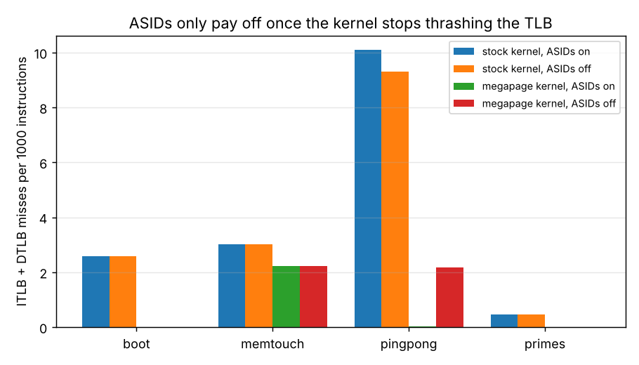
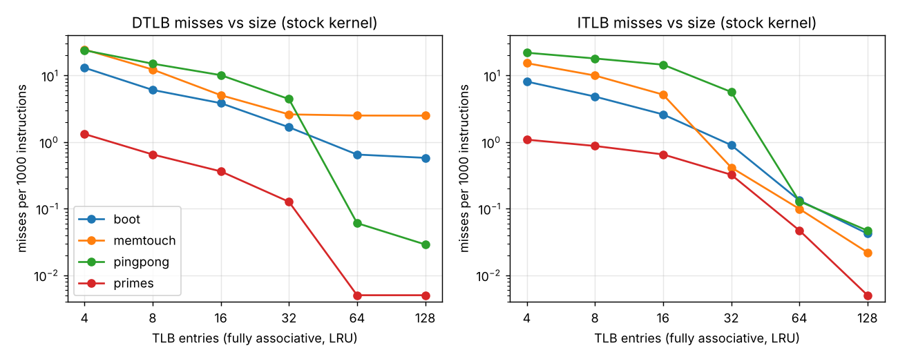

# bootlinux

A RISC-V full-system emulator, written from scratch in C++, that boots an
unmodified Linux 6.12 kernel to a shell, and is instrumented to study how a
real operating system uses the TLB.

```
$ make demo
[    0.000000] Linux version 6.12.0 ... riscv32
...
[    0.266641] Run /init as init process

bootlinux shell - type 'help'
# uname
Linux (none) 6.12.0 riscv32
# pingpong 50 8
pingpong: 50 rounds, 8 pages per side, checksum 166600
...
---- bootlinux statistics ----
instructions       33522349  (36.8 MIPS host speed)
  user / super / machine: 0.9% / 99.1% / 0.0%
ITLB ( 32)         33382511 lookups, 0.112% miss
DTLB ( 32)         13183898 lookups, 0.436% miss, 4.0% of hits on 4 MiB pages
page walks            94795  (fetch 37250, load 54852, store 2693), 189553 PTE reads
sfence.vma            33617  (all 4, page 33608, asid 5), satp writes 108
...
```

## What it implements

| | |
|---|---|
| ISA | RV32IMA + Zicsr + Zifencei, M/S/U privilege modes |
| Traps | precise exceptions and interrupts, `medeleg`/`mideleg` delegation, `mret`/`sret`, `wfi` |
| Virtual memory | Sv32 two-level page tables, 4 MiB megapages, hardware A/D bits, `sfence.vma` with address and ASID scoping |
| TLB | modeled split ITLB/DTLB: fully associative, LRU, configurable size, 9-bit ASIDs, optional superpage support |
| Devices | CLINT timer, SiFive PLIC, NS16550A UART (interrupt-driven) |
| Firmware | built-in SBI 2.0 (base, timer, IPI, RFENCE, HSM, system reset, debug console) in place of OpenSBI |
| Software | Linux 6.12 (stock, `tinyconfig` + `linux/bootlinux.config`), a 10 KB init shell built on the kernel's nolibc |

The TLB is not just a counter. Every translation goes through it, and a hit
uses the cached PTE without touching the page table. If `sfence.vma` or ASID
tagging were implemented wrongly, Linux would use stale translations and
crash, so the hit and miss numbers come from a TLB the OS actually depends on.

**Verification:** passes all 82 RV32 tests from the official
[riscv-tests](https://github.com/riscv-software-src/riscv-tests) suite
(`rv32ui`, `rv32um`, `rv32ua`, `rv32si`, `rv32mi`), including the `v`
variants that run user code under demand paging.

Time is derived from the instruction count (10 MHz timebase, one
instruction = 10 ns), so every run is deterministic and repeatable.

## The TLB study

`make study` runs 46 configurations (≈20 s) and writes
[`docs/results.md`](docs/results.md) plus the charts below. Workloads run in
the shell after boot: `memtouch` (touches 512 pages, 8 rounds),
`pingpong` (two processes bounce a byte through pipes 400 times, forcing 800
context switches) and `primes` (compute-bound). Workload numbers exclude boot.

### 1. Linux on RV32 maps all of RAM with 4 KiB pages

The first thing the counters showed was **32,778 single-page `sfence.vma`
instructions during a 30.7M-instruction boot**. Logging every fence's PC and
return address and resolving them against `vmlinux` put all but 14 of them
in one place: `__set_fixmap`, called from `get_pte_virt_fixmap`.

The cause is in `best_map_size()` in `arch/riscv/mm/init.c`: Linux maps RAM
(the kernel's *linear map*) with 4 MiB pages only `if (IS_ENABLED(CONFIG_64BIT))`.
On RV32, every 4 KiB page of RAM gets its own PTE, and each PTE write goes
through a temporary fixmap slot that costs two TLB flushes. That predicts
exactly 2 flushes per page of RAM, which the emulator confirms:

| RAM | boot-time single-page flushes | pages of RAM |
|---|---|---|
| 32 MiB | 16,394 | 8,192 |
| 64 MiB | 32,778 | 16,384 |
| 128 MiB | 65,546 | 32,768 |

The bigger cost is at run time: every kernel data access lands on a 4 KiB
mapping, so the kernel competes with user programs for TLB entries.

### 2. A one-line kernel patch removes almost all kernel page walks

[`linux/rv32-linear-megapages.patch`](linux/rv32-linear-megapages.patch)
drops the 64-bit-only condition so RV32 also maps RAM with 4 MiB megapages.
The patched kernel boots and runs every workload correctly. With 32-entry
TLBs:

| | stock kernel | megapage kernel |
|---|---|---|
| boot instructions | 30.68M | 28.72M (−6.4%) |
| boot page walks | 78,942 | 30 |
| boot DTLB / ITLB misses per 1K instructions | 1.67 / 0.90 | 0.00 / 0.00 |
| pingpong DTLB / ITLB MPKI | 4.43 / 5.67 | 0.02 / 0.00 |
| memtouch page walks | 7,016 | 5,136 |

`memtouch` improves least because most of its misses are on its own 512 user
pages, which are still 4 KiB pages.

The benefit needs both halves: a TLB that cannot hold superpages
(`--split-superpages`) gives the megapage kernel almost exactly the stock
kernel's miss rates. The OS has to create big mappings *and* the hardware has
to cache them as single entries.

### 3. ASIDs only pay off once the kernel stops thrashing the TLB



Without ASIDs, Linux flushes every non-global TLB entry on each
address-space switch (about 800 flushes in `pingpong`). With 9-bit ASIDs
it flushes twice. On the **stock** kernel that saves nothing: page walks
are 37,337 with ASIDs and 34,434 without, because the kernel's own 4 KiB
entries evict the user entries between switches anyway. On the **megapage**
kernel the same workload does **70 page walks with ASIDs vs 8,042 without,
115× fewer**. The two features interact: superpages free up the TLB, and only
then is there anything for ASIDs to preserve.

### 4. How big does the TLB need to be?



On the stock kernel, `pingpong` falls off a cliff between 32 and 64
entries (DTLB 4.43 → 0.06 MPKI): its working set (both processes' pages plus
the kernel's pipe and scheduler data) fits in 64 entries but not 32.
`memtouch` stays at 2.5 MPKI however large the TLB gets, because it cycles
through 512 pages, more than 128 entries can cover, so LRU misses on every
page. That's a capacity limit that only superpages or a bigger page size can fix.

## Building and running

Needs a RISC-V cross compiler (`gcc-riscv64-linux-gnu`), `device-tree-compiler`,
a Linux 6.12 source tree and Python 3 with matplotlib.

```
make                                            # emulator + device tree
LINUX_SRC=~/linux-6.12 linux/build.sh            # build/Image (stock)
LINUX_SRC=~/linux-6.12 linux/build.sh megapages  # build/Image-megapages
make boot                                       # interactive shell (Ctrl-A x quits)
make demo                                       # scripted session
RISCV_TESTS=~/riscv-tests make test             # official ISA tests
make study                                      # TLB study -> docs/
```

Emulator options: `--itlb N`, `--dtlb N`, `--asid-bits 0|9`,
`--split-superpages`, `--sfence-log FILE`, `--script FILE`, `--stats FILE`,
`--trace N`, `--ram MB`. Run `build/bootlinux` with no arguments for the full list.

## Layout

```
src/        emulator: cpu.cpp (decode, CSRs, traps, Sv32 walker), tlb.h,
            devices.cpp (CLINT, PLIC, UART), sbi.cpp, main.cpp
dts/        device tree describing the machine to Linux
linux/      kernel config fragment, initramfs list, build script, megapage patch
userspace/  init.c: the shell (PID 1), including the study workloads
tests/      riscv-tests runner, workload scripts
tools/      tlb_study.py
docs/       generated study results and charts
```

## Limitations

Single hart; no compressed (C), floating-point or vector instructions (the
kernel is built without them); the TLB model is fully associative with true
LRU, and the miss counts are not converted into cycles. Natural next steps:
set-associative TLBs, a page-walk cache, and a cycle cost per walk so the
results can be expressed as CPI.
